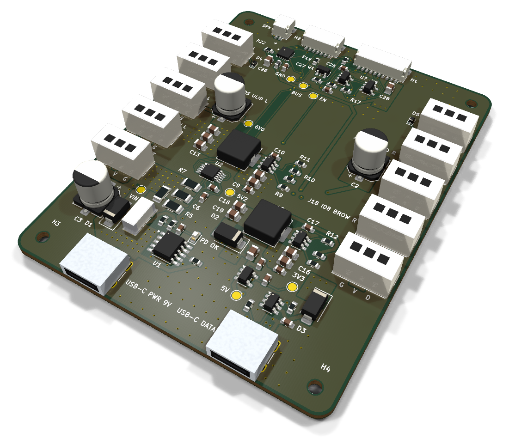
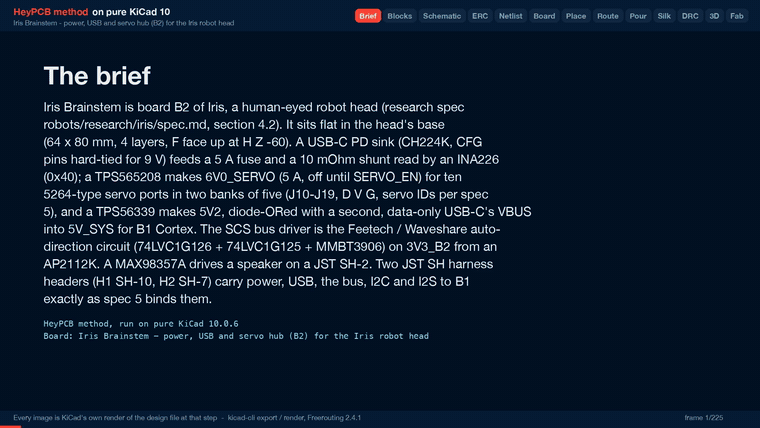
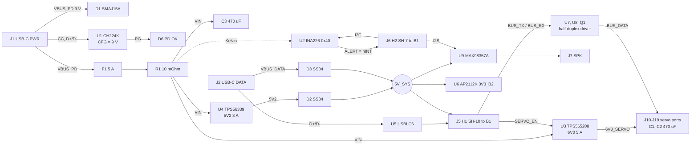

# Iris Brainstem

The power and servo hub in the base of Iris: 9 V USB-C PD in, a 6 V / 5 A servo rail laid in stitched copper zones, a 5 V rail, the half-duplex servo bus with ten ports, a speaker amp and a USB-C data port.

Part of [Iris, the human-eyed robot head](https://github.com/HeyPCB/iris), HeyPCB's open robot boards. Designed end to end with the HeyPCB method on
KiCad 10 (headless pipeline, Freerouting 2.4.1); every number below is measured on the files in this repository.
Mentions of `./run.sh`, `docs/rules/`, `blocks/` or `parts/` refer to the heypcb-kicad SDK that produced them.

<p align="center"></p>

| Layers | Outline | Parts | Nets | Connections routed | Vias | ERC errors | DRC errors / unconnected / parity |
|---|---|---|---|---|---|---|---|
| 4 | 64 x 80 mm, shaped | 97 | 48 | 230 -> 0 open | 208 | 0 | 0 / 0 / 0 |

**Not fabricated, assembled or powered.**

| | |
|---|---|
| KiCad project | [`kicad/`](kicad/) |
| Gerbers (unzipped and zipped), BOM, CPL, STEP, schematic PDF | [`fab/`](fab/) |
| Mechanism CAD, fit check and system docs | [Iris, the human-eyed robot head](https://github.com/HeyPCB/iris) |
| Renders | [top](media/top.png), [bottom](media/bottom.png) |
| Design process, every step as KiCad rendered it | [`media/design-process.mp4`](media/design-process.mp4) |

<p align="center"></p>

Iris Brainstem is board B2 of Iris, a robot head with human-like eyes. It sits flat in the base of
the head and is the head's power, USB and servo hub. It takes 9 V from a USB-C PD charger, makes a
6.0 V / 5 A rail for the ten eye, lid and brow servos and a 5 V rail for the head controller (B1
Cortex), measures the input with an INA226, drives the servos' half-duplex serial bus and the
speaker, and passes a second USB-C port's data up to B1. It was designed with the HeyPCB method on
KiCad 10 (10.0.6), by heypcb-kicad's headless pipeline with Freerouting 2.4.1, from the brief in
`board.json` and section 4.2 of the Iris design spec v0.1 (not published; its binding interconnect and mounting
contracts are in [the Iris system docs](https://github.com/HeyPCB/iris/blob/main/docs/system.md)).

**This board has not been fabricated, assembled or powered, and no firmware for it has been
written.** Everything below is what KiCad, the pipeline and the copper scripts measured on the
design files. Nothing here has been tested on hardware or in the head.

## Role in Iris

Iris has four boards (spec 4): **B1 Cortex** (ESP32-S3, camera, on the eye cradle), **B2
Brainstem** (this board, in the head's base), **B3 Iris ring** (two LED rings) and **B4 Brow**
(forehead sensors). B2 is where power enters the head and where every servo plugs in:

- USB-C **J1 PWR** brings 9 V. Everything in the head is powered from here.
- USB-C **J2 DATA** carries a PC's USB to B1's native USB, and its VBUS powers the logic on its own
  (servos stay off).
- **H1** (JST SH-10) and **H2** (JST SH-7) are the two harnesses to B1: 5V_SYS, USB, the servo bus
  and SERVO_EN on H1; I2C, the INA226's alert and I2S audio on H2 (spec 5).
- **J10-J19** are the servo ports, **J7** the speaker.

## Features

- **USB-C PD sink, 9 V, no firmware.** WCH CH224K (U1) with CFG1, CFG2 and CFG3 tied straight to
  GND, which requests 9 V. There is no configuration resistor to go missing: on the CH224K a
  missing resistor on CFG1 would request 20 V. VDD through 1 kOhm with 1 uF, VBUS sense through
  10 kOhm (WCH's reference schematic). A red **PD OK** LED (D6) hangs on the CH224K's PG output
  (open drain, active low).
- **Input protection and measurement.** SMAJ15A TVS (D1), 5 A Littelfuse NANO2 fuse (F1,
  0451005.MRL), 10 mOhm 1206 shunt (R1) read by an **INA226 at 0x40** (U2, ALERT on H2 pin 4), and
  470 uF on VIN (C3).
- **6V0_SERVO, 5 A.** TPS565208 buck (U3) to 5.93 V (68 k / 10 k on a 0.760 V reference), 3.3 uH
  FXL0630, 3 x 22 uF at the regulator and 470 uF at each servo bank (C1, C2). **Off by default**:
  EN is SERVO_EN from B1 through 1 kOhm with a 100 kOhm pull-down.
- **5V2 and 5V_SYS.** TPS56339 buck (U4) to 5.21 V (54.9 k / 10 k on 0.802 V), 5.6 uH FXL0630, then
  an SS34 (D2) onto 5V_SYS. J2's VBUS joins 5V_SYS through a second SS34 (D3). Neither VBUS is
  ever driven by the board. 5V_SYS goes to B1 on H1 pins 1-2 and to the amplifier.
- **3V3_B2.** AP2112K-3.3 (U6) from 5V_SYS for the INA226, the bus buffers and their pull-ups.
- **Servo bus.** The Waveshare / Feetech auto-direction half-duplex driver: 74LVC1G126 (U7),
  74LVC1G125 (U8) and an MMBT3906 (Q1), 10 k pull-ups on BUS_TX, BUS_RX and BUS_DATA, an ESD5Z5.0 on
  BUS_DATA at each bank (D4, D5). TX is never echoed back to RX.
- **Ten servo ports** (J10-J19), HC-5264-3A vertical (Molex 5264 type), pin 1 BUS_DATA, pin 2
  6V0_SERVO, pin 3 GND, in two banks of five down the left and right edges. **D V G** is printed at
  every port and each port is labelled with its servo ID.
- **Speaker amplifier.** MAX98357A (U9) on B1's I2S, mono (L+R)/2 (1 MOhm on SD_MODE), 9 dB gain,
  from 5V_SYS through a ferrite, to a JST SH-2 (J7). Bridge-tied output: neither wire is ground.
- **USB data port.** J2 with 5.1 kOhm on CC1 and CC2 (a plain sink) and a USBLC6-2SC6 (U5) on D+ /
  D- before H1.
- **Test pads** (1.5 mm, not fitted parts): VIN, 6V0, 5V2, 5V_SYS, 3V3_B2, BUS_DATA, SERVO_EN and
  GND (TP1-TP8).
- **Board:** 64.0 x 80.0 mm, corner fillet 3.0 mm, 1.6 mm, 4 copper layers: F.Cu signal and power
  zones, In1 a solid GND plane, In2 signal with a 6V0_SERVO pour, B.Cu mostly a power layer
  (6V0_SERVO, VIN and 5V_SYS zones, with keep-outs that hold signal tracks off them; 101.5 mm of
  track runs on B.Cu elsewhere). Every part is on the top side. Four non-plated 2.2 mm holes for
  M2 screws.

## Block diagram



## Power tree and what the copper carries

```
J1 VBUS_PD, 9 V ─┬─ D1 SMAJ15A to GND
                 └─ F1 5 A ─ R1 10 mOhm (INA226) ─ VIN ─┬─ C3 470 uF
                                                        ├─ U3 TPS565208 ─ 6V0_SERVO ─ C1, C2 470 uF ─ J10-J19 pin 2
                                                        └─ U4 TPS56339 ─ 5V2 ─ D2 SS34 ─┐
J2 VBUS_DATA, 5 V ─ D3 SS34 ────────────────────────────────────────────────────────────┴─ 5V_SYS

5V_SYS ─┬─ H1 pins 1-2 (to B1)
        ├─ FB1 ─ U9 MAX98357A ─ J7 speaker
        └─ U6 AP2112K ─ 3V3_B2
```

The input enters at the rear left (J1), and F1, R1 and C3 stand in one column above it. The servo
buck sits in the middle of the board, with its output node (L1, three 22 uF and C1) on the left,
and the ten ports run down both side edges. The 5V2 buck and the two diodes are at the rear right,
beside J2.

**Load figures** (spec 6, all estimates, none measured): VIN 0.68 A typical, about 4.3 A for
milliseconds (39 W); 6V0_SERVO 0.58 A typical, a 7-servo burst of 4.6 A for milliseconds, 9 A if
every servo stalls (beyond the buck's 5 A by design: firmware must cut torque); 5V_SYS 0.41 A
typical, 1.56 A peak. A 27 W (9 V, 3 A) PD charger is the spec's supply.

**Net classes** (from the brief; a class with a current is never narrowed by the routing ladder):
PDIN 0.6 mm (VBUS_PD, VIN_F, VIN; 0.6 mm is the receptacle's VBUS pads and the bucks' VIN pins),
SERVO 0.8 mm with 0.8 / 0.4 mm vias (6V0_SERVO), SWNODE 0.6 mm (the two switch nodes), RAIL5V
0.6 mm (5V2, 5V_SYS), USBVBUS 0.6 mm (VBUS_DATA). The tracks only connect the path. The current is
carried by the zones below.

### Power zones

After routing reaches 0 open, the pour stage lays the plan pours (GND on F.Cu, B.Cu and In1,
6V0_SERVO on In2) and then the brief's `board.zones`: each a named net's copper over a region on
chosen layers, above the plan pours, with every pad joined solid, and where the zone has a
`stitch` pitch, its own 0.6 / 0.3 mm via lattice. Board coordinates are mm from the outline's
top-left corner (y = 0 is the front edge). Every reason is also in `board.json`.

| Zone | Net | Layers | Region | Priority | Vias placed |
|---|---|---|---|---|---|
| `vbus_pd` | VBUS_PD | F.Cu, B.Cu | J1's VBUS pads, D1's cathode, F1's input pad (x 9.6-21.6, y 64.4-71.7) | 1 | 20 at 1.2 mm |
| `vin_f` | VIN_F | F.Cu | F1's output pad to R1, and the INA226's IN+ resistor (x 14.6-19.7, y 57.6-62.7) | 2 | - |
| `vin_col` | VIN | F.Cu, B.Cu | R1's VIN pad, C3's + pad, the INA226's IN- / VBUS taps (polygon in x 5.4-19.7, y 51.6-63.4) | 3 | 27 at 1.2 mm |
| `vin_band` | VIN | B.Cu | from the input column to both buck inputs (x 9.6-44.8, y 44.9-57.4) | 2 | - |
| `vin_u3`, `vin_u4` | VIN | F.Cu, B.Cu | each buck's VIN pin and input capacitors | 10 | 4 and 5 at 1.2 mm |
| `v6_b` | 6V0_SERVO | B.Cu | a U: the left bank strip, a bar along the front (y 7.3-12.5), the right bank strip | 5 | - |
| `v6_node` | 6V0_SERVO | F.Cu, B.Cu | L1's output pad, the three 22 uF and C1 (x 14.6-23.0, y 31.6-44.7) | 6 | 8 at 1.2 mm |
| `v6_bank_l`, `v6_bank_r`, `v6_c2` | 6V0_SERVO | F.Cu | the V pins of each bank (x 4.6-7.45 and 56.55-59.4, y 12.5-57.0) and C2 | 7, 8 | - |
| `gnd_out6`, `gnd_in6`, `gnd_in5` | GND | F.Cu | the GND sides of the servo buck's output and input capacitors and of the 5V2 buck's input | 9 | 12, 5 and 0 at 1.2 mm |
| `gnd_front`, `gnd_mid`, `gnd_rear` | GND | F.Cu, B.Cu | the front strip, the middle and the rear right, where the plan pour would otherwise have no vias | 0 | 16, 21 and 51 at 2.4 mm |
| `v5_spine` | 5V_SYS | B.Cu | from D2 / D3 at the rear, up the right of the middle (x 45.4-50.8) to H1 | 12 | - |
| `v5_front`, `v5_link_*` | 5V_SYS | F.Cu (+ B.Cu) | H1's pins 1-2, and the three places the spine meets F.Cu (D2, D3, H1) | 12, 13 | 3, 5 and 3 at 1.2 mm |
| `sw_6v0`, `sw_5v2` | SW_6V0, SW_5V2 | F.Cu | the gap between each buck's SW pin and its inductor | 11 | - |
| `v5v2_out` | 5V2 | F.Cu | L2's output pad, the two 22 uF and D2's anode (polygon in x 30.4-36.6, y 51.6-60.4), left of VIN's F.Cu track to U4 | 14 | - |

B.Cu is kept free of signal tracks under these zones by seven `board.keepouts` rectangles
(`bcu_*`), and In2 is kept free of tracks where the VBUS_PD, VIN and the servo buck's via fields
need room (`in2_*`): a stitch via must clear other nets' tracks on every layer. `gnd_in5` found no
via site (U4's GND pins reach In1 through the plan's own vias). Any GND zone stops the plan's GND
stitcher, so the plan's stitching count is 0 and the GND zones stitch themselves. The silkscreen
then displaced 25 GND stitching vias under its text, which leaves **208 vias** on the board (*read
off the board*: 206 of 0.6 / 0.3 mm and 2 of 0.8 / 0.4 mm; 53 of them are routing vias).

### Measured copper on the current path

`copper.py` (KiCad's Python) lists every track, via and pour of each power net on the final board
and exports the copper (tracks, pads, plan pours and zones) as polygons. `copper_cut.py` (any
Python with numpy and scipy) rasterises that copper on a 0.1 mm grid and finds, for each link of
the path, the **narrowest cross-section the link's whole current must pass**: a max-flow / min-cut
from the link's source pads to its sink pads, over every layer, with tracks, zones and via barrels
together, in parallel. Outer copper is taken as 35 um, inner as 17.5 um (JLCPCB's standard 4-layer
build), via plating as 25 um. Each cut is rated with `heypcb_kicad.route.ipc2221_amps` (IPC-2221,
I = k dT^0.44 A^0.725), per layer, summed. Each link is cut a second time with the copper within
1 mm of its pads counted as the pads ("beyond the pads"): that rates the board's own copper between
the parts, apart from the parts' fixed lands. Both scripts are copies of quack_core's, adapted.

| Link | From, to | Narrowest cross-section (35 um equivalent) | 10 C rise | **20 C rise** | Beyond the pads, 10 C / 20 C |
|---|---|---|---|---|---|
| VBUS_PD | J1 VBUS pads (A4, A9, B4, B9) to F1.1 | 1.15 mm of F.Cu, at the receptacle's VBUS pads | 2.6 A | **3.6 A** | 9.0 A / 12.2 A (6.23 mm) |
| VIN_F | F1.2 to R1.1 | 4.24 mm of F.Cu | 6.8 A | **9.2 A** | pads adjacent |
| VIN, both bucks | R1.2 to U3 and U4 VIN pins and their input capacitors | 5.09 mm of F.Cu | 7.8 A | **10.6 A** | 9.3 A / 12.6 A (In2 0.25, barrels 6.06) |
| VIN, servo buck | R1.2 to U3.3, C7.1, C8.1 | 3.08 mm: In2 0.39, 4 via barrels 2.69 | 5.5 A | **7.5 A** | 5.5 A / 7.5 A |
| SW_6V0 | U3.2 to L1.1 | 0.80 mm of F.Cu: U3's SW pin | 2.0 A | **2.8 A** | pads adjacent |
| 6V0_SERVO, all ports | L1.2 to J10-J19 pin 2 | 6.09 mm: F.Cu 0.70, 8 via barrels 5.39 | 10.0 A | **13.5 A** | 10.0 A / 13.5 A |
| 6V0_SERVO, each bank | L1.2 (with C11-C13, C1) to J10-J14 or J15-J19 pin 2 | 6.09 mm, the same section | 10.0 A | **13.5 A** | 10.0 A / 13.5 A |
| 6V0_SERVO, bank to bank | J10-J14 pin 2 to J15-J19 pin 2 | 7.61 mm: In2 2.82, B.Cu 4.78 | 10.0 A | **13.5 A** | 13.4 A / 18.2 A |
| GND, ports to servo buck | J10-J19 pin 3 to U3.1, C11-C13 pin 2 | 8.63 mm of F.Cu | 11.4 A | **15.5 A** | 13.3 A / 18.0 A |
| GND, servo buck to input | U3.1, C7.2, C8.2 to J1 GND pads | 2.97 mm of F.Cu | 5.3 A | **7.1 A** | 13.4 A / 18.2 A (F.Cu 5.74, barrels 2.69) |
| 5V2 | L2.2 to D2.2 (anode) | 1.04 mm of F.Cu | 2.5 A | **3.3 A** | 2.5 A / 3.3 A |
| 5V_SYS | D2.1, D3.1 (cathodes) to J5 pins 1-2 | 0.99 mm of F.Cu | 2.4 A | **3.2 A** | 2.4 A / 3.2 A |

*Read off the board* (`copper_cut.json`, `copper.json`) after the full run with
media. "Pads adjacent" means the two terminals are within 2 mm of each other, so the link is the
pads' own gap.

**What this says against spec 6.** At a 10 C rise on 1 oz outer copper:

- **The servo rail has about twice the copper its burst needs.** 6V0_SERVO from L1 to the ports
  rates 10.0 A (13.5 A at 20 C) against the 4.6 A burst and the buck's 5 A limit. The narrowest
  section is at L1's output node, where the F.Cu node meets the eight vias of `v6_node`; past that
  the current spreads over the B.Cu U, the In2 pour and the F.Cu bank strips. The GND return from
  the ports to the buck's output capacitors rates 11.4 A.
- **The input path carries the 4.3 A peak** at a 10 C rise on every board-copper link: VIN_F
  6.8 A, VIN to both bucks 7.8 A, VIN to the servo buck 5.5 A, the GND return from the buck input
  to J1 5.3 A (13.4 A beyond the pads).
- **Two links end on a part's own pins and rate lower by this rule.** VBUS_PD leaves the
  receptacle through its VBUS pads: 1.15 mm of copper at the pads' edges, 2.6 A at 10 C and 3.6 A
  at 20 C, against the 3 A PD contract and the millisecond 4.3 A peaks. Beyond the pads the zone
  is 6.23 mm (9.0 A). SW_6V0 is the TPS565208's 0.8 mm SW pin, 2.0 A by the chart against a 5 A
  switch current. Both are lands fixed by the footprint and well under 2 mm long; IPC-2221's chart
  is for long conductors, so these figures say little about the real limit, and neither was
  measured. The receptacle's current rating was not checked (see *Check before ordering*).
- **5V2 and 5V_SYS** rate 2.5 A and 2.4 A (3.3 A and 3.2 A at 20 C) against the 1.56 A peak.
  H1's two 5V_SYS pins are JST SH contacts rated 1 A each (catalogue rows), 2 A together, which
  the spec's 1.6 A respects.
- Via barrels are rated with the same formula as a plated wall; that is an approximation.

Nothing here is a measured temperature. Measure F1, R1, J1, U3, L1 and the port headers under the
real servo load before trusting any of it. The routed widths of the rest of the power nets, *read
off the board*: VBUS_DATA 0.6 mm (0.45 mm necks at pads, 2 vias), SW_5V2 0.6 mm plus its zone,
VIN's routed tracks 0.6 mm.

## Connectors and pinouts

Every connector follows spec 5 (binding). "Pin n" is pad n of the KiCad footprint. Both harness
cables are **double-ended, same direction** (pin n to pin n), 28 AWG, 150 mm. The SH headers are
side-entry with their mouths at the front edge; the board's header pin counts (10, 7, 2) all
differ, so no cable fits a wrong header.

### H1: J5, JST SH-10 (SM10B-SRSS-TB, C160409) to B1 J5

| Pin | Net | Direction | Level / type | Notes |
|---|---|---|---|---|
| 1 | 5V_SYS | B2 -> B1 | 4.85 V nominal (5V2 - SS34), <= 1.6 A total on pins 1-2 | source B2 |
| 2 | 5V_SYS | B2 -> B1 | as pin 1 | |
| 3 | GND | - | | |
| 4 | GND | - | | |
| 5 | USB_DN | both | USB 2.0 FS D-, 90 Ohm pair with 6 | ESD on B2 (U5); B1 GPIO19 |
| 6 | USB_DP | both | USB 2.0 FS D+ | B1 GPIO20 |
| 7 | GND | - | | separates the USB pair from the UART |
| 8 | BUS_TX | B1 -> B2 | 3.3 V UART, 1 Mbps, 8N1, idle high | B1 GPIO42 -> U7 A + Q1 base network (10 k pull-up on B2) |
| 9 | BUS_RX | B2 -> B1 | 3.3 V UART | U8 Y -> B1 GPIO44; 10 k pull-up on B2 |
| 10 | SERVO_EN | B1 -> B2 | 3.3 V CMOS, active high | -> U3 EN via 1 k; 100 k pull-down on B2 |

The board's nets carry the spec's names (USB_DN, USB_DP, BUS_TX and so on). The USB pair is routed
as two plain signals, without an impedance class (USB full speed). The mounting tabs are grounded.

### H2: J6, JST SH-7 (SM07B-SRSS-TB, C160406) to B1 J6

| Pin | Net | Direction | Level / type | Notes |
|---|---|---|---|---|
| 1 | GND | - | | |
| 2 | I2C_SDA | both | 3.3 V open drain, 400 kHz | pull-ups 2.2 k on B1 only (none on B2) |
| 3 | I2C_SCL | B1 -> | 3.3 V open drain | |
| 4 | nINT | B2 -> B1 | open drain, active low | INA226 ALERT; 10 k pull-up on B1 (GPIO3) |
| 5 | I2S_BCLK | B1 -> B2 | 3.3 V, 3.072 MHz (48 kHz x 64) | 33 Ohm series at B1; -> U9 BCLK |
| 6 | I2S_WS | B1 -> B2 | 3.3 V, 48 kHz | 33 Ohm series at B1; -> U9 LRCLK |
| 7 | I2S_AMP_SD | B1 -> B2 | 3.3 V I2S data | -> U9 DIN |

The mounting tabs are grounded.

### SPK: J7, JST SH-2 (SM02B-SRSS-TB, C160402)

Pin 1 OUTP (SPK_P, marked "+" on the silkscreen), pin 2 OUTN (SPK_N). A bridge-tied load:
**neither wire is ground.** 4-8 Ohm, about 1 W speaker (spec 5). The mounting tabs are grounded.

### USB-C: J1 PWR and J2 DATA (HRO TYPE-C-31-M-12, C165948)

- **J1 PWR.** CC1 / CC2 to the CH224K; VBUS to D1 and F1; D+ / D- to the CH224K's DP / DM (BC1.2
  only, not to B1).
- **J2 DATA.** CC1 / CC2 each 5.1 kOhm to GND; D+ / D- through U5 to H1 pins 6 / 5; VBUS through D3
  to 5V_SYS. The board never drives this VBUS.
- **J2 only** (a PC): logic runs, servos stay off (VIN reads 0 V). **J1 only:** everything runs,
  with no USB data. **Both:** 5V_SYS takes the higher of 5V2 and J2's VBUS, each through its own
  SS34.

### Servo ports: J10-J19 (HC-5264-3A, C2845815; footprint Molex_SPOX_5267-03A vertical)

| Pad | Net | Silkscreen | Notes |
|---|---|---|---|
| 1 | BUS_DATA | D | 3.3 V half-duplex, 1 Mbps; 10 k pull-up to 3V3_B2; ESD5Z5.0 at each bank |
| 2 | 6V0_SERVO | V | source B2 (U3); at most 1 A per port (stall) |
| 3 | GND | G | |

Watch the numbering: Feetech numbers the servo's own plug "1 GND, 2 Vcc, 3 Signal"; Waveshare
numbers the mating header "1 DATA, 2 VCC, 3 GND". The board follows Waveshare (pad 1 = DATA), as
spec 5 binds, and prints D / V / G beside every port. Pad 1 (square) is the outboard pin in both
banks.

**Port to servo ID (binding for firmware, spec 5), printed beside each port:**

| Port | J10 | J11 | J12 | J13 | J14 | J15 | J16 | J17 | J18 | J19 |
|---|---|---|---|---|---|---|---|---|---|---|
| Servo | ID 2 pan L | ID 5 upper lid L | ID 7 lower lid L | ID 9 brow L | ID 3 tilt | ID 1 pan R | ID 4 upper lid R | ID 6 lower lid R | ID 8 brow R | spare |
| Silk | J10 ID2 PAN L | J11 ID5 ULID L | J12 ID7 LLID L | J13 ID9 BROW L | J14 ID3 TILT | J15 ID1 PAN R | J16 ID4 ULID R | J17 ID6 LLID R | J18 ID8 BROW R | J19 SPARE |

### Test pads

| Pad | Net | Silkscreen | Board position (x, y) |
|---|---|---|---|
| TP1 | VIN | VIN | 12.80, 58.30 |
| TP2 | 6V0_SERVO | 6V0 | 21.55, 33.00 |
| TP3 | 5V2 | 5V2 | 28.00, 50.30 |
| TP4 | 5V_SYS | 5V | 40.90, 68.55 |
| TP5 | 3V3_B2 | 3V3 | 48.35, 62.35 |
| TP6 | BUS_DATA | BUS | 26.00, 17.10 |
| TP7 | SERVO_EN | EN | 29.40, 18.85 |
| TP8 | GND | GND | 22.60, 16.60 |

## Outline, holes and connector positions (for the mechanism CAD)

Board coordinates are mm from the outline's top-left corner, F face up; y = 0 is the front edge
(toward the face). The head frame H follows spec 4.2 (binding): **F face at Z = -60.0, Y = 32 - x,
X = -30 - y**. *Read off the board* with KiCad 10.0.6's `pcbnew`.

- **Outline:** 64.0 x 80.0 mm, fillet 3.0 mm, 1.6 mm thick. H: X -30 (front edge) to -110 (rear
  edge), Y +32 (x = 0, the robot's left) to -32.
- **Holes:** four 2.2 mm non-plated holes for M2 at (4, 4), (60, 4), (4, 76), (60, 76) = H (X, Y)
  (-34, +28), (-34, -28), (-106, +28), (-106, -28), onto the base plate's bosses (tops at Z -61.6).
  No track or via comes within 2.75 mm of a hole's centre.

| Part | Board centre (x, y), rotation | H (X, Y) of the centre | Extent on the board | Faces |
|---|---|---|---|---|
| J1 USB-C PWR | (17.00, 76.30), 0 | (-106.30, +15.00) | body x 12.53-21.47, y 72.65-79.95 | rear: mouth at the rear edge (H X -110), facing -X |
| J2 USB-C DATA | (47.00, 76.30), 0 | (-106.30, -15.00) | body x 42.53-51.47, y 72.65-79.95 | rear, as J1 |
| J5 H1 SH-10 | (38.50, 3.40), 180 | (-33.40, -6.50) | courtyard x 31.56-45.44, y 0.08-6.72; pin 1 at (43.00, 5.40) | front: mouth toward the front edge, facing +X |
| J6 H2 SH-7 | (23.50, 3.40), 180 | (-33.40, +8.50) | courtyard x 18.06-28.94, y 0.08-6.72; pin 1 at (26.50, 5.40) | front, as J5 |
| J7 SPK SH-2 | (13.00, 3.40), 180 | (-33.40, +19.00) | courtyard x 10.06-15.94, y 0.08-6.72; pin 1 at (13.50, 5.40) | front, as J5 |
| J10-J14 (left bank) | pin 1 at x 3.50, y 16.50 / 26.00 / 35.50 / 45.00 / 54.50 | pin 1 at Y +28.50, X -46.50 / -56.00 / -65.50 / -75.00 / -84.50 | pins at x 3.5, 6.0, 8.5; courtyards x 0.50-11.50, 6.0 mm deep in y | up (+Z), vertical headers |
| J15-J19 (right bank) | pin 1 at x 60.50, y 15.20 / 24.70 / 34.20 / 43.70 / 53.20 | pin 1 at Y -28.50, X -45.20 / -54.70 / -64.20 / -73.70 / -83.20 | pins at x 60.5, 58.0, 55.5; courtyards x 52.50-63.50 | up (+Z) |
| C1, C2 (470 uF, 6.3 x 7.7 mm cans) | (16.00, 31.00), (48.00, 31.00) | (-61.00, +16.00), (-61.00, -16.00) | courtyards 7.2 x 9.5 mm | |
| C3 (470 uF can) | (7.00, 64.00) | (-94.00, +25.00) | courtyard x 3.41-10.59, y 59.25-68.75 | |
| L1, L2 (FXL0630, 7 x 6.6 mm) | (24.30, 41.00), (38.30, 53.50) | (-71.00, +7.70), (-83.50, -6.30) | courtyards about 9 x 7.2 mm | |

Every part is on the F side. The tallest are the 5264 headers, the 470 uF cans and the
inductors; the spec allows 12 mm on F (Z -48). The through-hole tails of J10-J19 and the USB-C
receptacles' shell legs come through to the B side, where the spec allows 2 mm; their length below
the board was not checked. The pipeline's STEP (`fab/iris_brainstem.step`)
uses generated bodies, not vendor models, so take heights from the parts' drawings.

## Where the board differs from the spec

| Spec | On the board | Why |
|---|---|---|
| U5 USBLC6-2SC6 C2687116 (UMW) | **C7519**, STMicroelectronics' own USBLC6-2SC6 | The pinned table prefers ST's part over the clone; same pinout, same KiCad symbol |
| "PD OK" LED from 3V3_B2 through a resistor into PG | LED (D6) and 2.2 kOhm from the **CH224K's own VDD** into PG | With only J2 plugged in, 3V3_B2 is up while the CH224K is unpowered; an LED from 3V3_B2 into PG would back-feed the unpowered chip. From VDD it draws about 0.6 mA of the 5.7 mA the 1 kOhm VDD resistor supplies at 9 V |
| C1-C3 "470 uF 16 V polymer", C2977552 | the spec's own C2977552, which is RVT1C471M0607, a **general-purpose aluminium electrolytic** (185 mA ripple at 120 Hz, catalogue row) | Kept the spec's part number. TI's TPS565208 table assumes 20-68 uF of ceramics; the 940 uF of electrolytic bulk on 6V0 is outside it (see *Check before ordering*) |
| Layers "F / GND / 6V0 + 5V pours / B" | F.Cu / In1 GND / In2 signal + 6V0_SERVO pour / B.Cu power zones | The 5 V rails need little copper (1.6 A); B.Cu carries the 6V0_SERVO U, the VIN band and the 5V_SYS spine, with signal tracks kept off those zones, and In2 carries signals |
| Test pads VIN, 6V0, 5V2, 5V_SYS, 3V3_B2, BUS_DATA, SERVO_EN | the same plus **GND** (TP8) | A probe needs a ground next to the bus pads |
| (not specified) | SH header mounting tabs grounded; 10 Ohm / 100 nF INA226 input filter; 1 uF on J2's VBUS | Data sheet practice (INA226: 10 Ohm or less per line) |

Everything else follows spec 4.2's parts table and spec 5's contracts: the same reference
designators (U1-U9, D1-D5, C1-C3, F1, R1, J1, J2, J5-J7, J10-J19), the same parts and the same
pinouts. Part numbers came from the pinned table or from live jlcsearch lookups on 2026-10-03,
pinned in `parts/lcsc_pinned.json` with that date.

## What it measured

A full run with media on 2026-10-03 (`./run.sh --board boards/iris_brainstem`, KiCad 10.0.6,
Freerouting 2.4.1). Gate numbers are from `report.json`. Anything marked *read
off the board* was measured on `kicad/iris_brainstem.kicad_pcb` with `pcbnew`.

| Gate | Result |
|---|---|
| Composition | 97 parts, 48 nets (13 block instances of 12 new `brainstem_*` blocks) |
| Part binding | 85 of 97 parts bound to an LCSC number, 0 unsourced, 0 identity conflicts. The other 12 are not BOM parts: the four mounting holes and the eight test pads. 24 distinct Extended parts, about $72 in JLC loading fees |
| ERC (`kicad-cli sch erc --severity-all`) | **0 errors**, 1 warning (`pin_to_pin`: the MAX98357A's exposed pad, typed "unspecified" in KiCad's symbol, on GND) |
| Netlist round trip | **identical**, 48 nets |
| Routing, rung 1, fanout on | **230 -> 0 open** by Freerouting alone, 28.3 s, 53 vias. **This solve is kept** |
| Routing, rung 1, fanout off | 0 open after the last-mile router closed one 3V3_B2 connection (4 vias), 89.8 s |
| Net classes | none narrowed (every power class carries a current) |
| Copper | 770 tracks, 2001.4 mm (F.Cu 1318.6, In2 581.2, B.Cu 101.5), 53 routing vias |
| Pours and zones (laid only after a measured 0 open) | Plan: GND on F.Cu, B.Cu and In1, 6V0_SERVO on In2. The 25 `board.zones` above them, with 180 zone vias (GND 105, VIN 36, VBUS_PD 20, 5V_SYS 11, 6V0_SERVO 8). 0 open after the pours and after stitching, 0 island-repair vias |
| Silkscreen | 55 words and marks placed (24 words, 30 port letters, the speaker's "+"), 39 designators seated and 34 hidden, the 6 back-side title lines placed as one block (offset 5.0, -3.0 mm from the brief's spot). The text displaced 25 GND stitching vias; 6 footprint silk strokes at or past the edge were dropped |
| DRC (`kicad-cli pcb drc --severity-all --schematic-parity`) | **fresh, 0 errors, 0 unconnected, 0 parity issues**, 2 warnings (`lib_footprint_mismatch` on J1 and J2: the silk clip dropped 3 of each receptacle's 5 silk strokes at the rear edge, *read off the board*). One repair before the final check: J13 pin 3's starved thermal became a solid zone connection |
| DFM (`jlcpcb_4layer`) | **0 errors**, 1 warning: 330 stock-footprint silk strokes at 0.12 mm, which the fab prints at its 0.15 mm minimum |
| Fab gate | **ready**, no blockers. 4 copper gerbers and a gerber job with LayerNumber 4, 1.6 mm; drill, BOM, JLC CPL (9 rotations corrected), schematic PDF, STEP |
| 3D, renders, video | all ran: 63 3D frames, the renders (492.7 s, on a machine shared with other boards' runs) and the design-process video (225 stills; 151.4 s at 1920 x 1080 by ffprobe) |

Nothing on the board was edited by hand: every track came from Freerouting, every pour and stitching
via from the pipeline.

### Why the brief looks the way it does

Measured on the runs of 2026-10-03; each reason is also in `board.json` beside its key.

- **B.Cu is a power layer.** Seven B.Cu track keep-outs keep Freerouting's signals off the bank
  strips, the front bar, the VIN band and the 5V_SYS spine, so no signal track splits the zones
  there.
- **Stitched zones carry the higher priority.** Where two zones of one net overlap, only the higher
  priority fills. `vin_col` (stitched, F.Cu and B.Cu) placed 0 vias under the B.Cu VIN band until
  the band went one priority below it; then 29 (27 after the last placement changes).
- **In2 keep-outs give the via fields room.** A stitch via must clear other nets' tracks on every
  layer, so In2 tracks are kept out of the input column and the servo buck's input and output via
  fields. The 5V2 buck's In2 keep-out was narrowed to x 40.6-44.6: wider, the USB pair could not
  leave the rear right and the USB D- line stayed open.
- **The test pads sit on their own rails.** A row of test pads across the middle needed long traces
  through the power copper; the VIN pad's trace cut the servo buck's output-capacitor ground off its
  vias (its GND return fell to 0.59 mm).
- **The 5 V rails stay at 0.6 mm, and 5V2's output has a zone.** At 0.8 mm Freerouting ran 5V2 and
  5V_SYS as long In2 runs, which rate lower on 0.5 oz copper, and left the USB D- line open. At
  0.6 mm 5V2 is F.Cu only, but its routed track from L2 to D2 measured 0.51 mm at the min-cut,
  1.5 A at 10 C against the 1.56 A peak. The `v5v2_out` zone, added on the same route, took it to
  1.04 mm (2.5 A).
- **The 5V_SYS spine's links were moved to clear other nets.** Its front link sat behind H1's USB_DP
  track (min-cut 0.25 mm) until it moved to x 41.5-45; its rear arm knocked out the 5V2 buck's VIN
  field (0 vias) until it moved to y 61.2-63.4.
- **C3, TP1 and the PD OK row were moved for their labels.** C3 moved 2 mm toward the rear so J14's
  D / V / G letters fit; TP1 moved to (12.8, 58.3) and the CH224K's support row 0.25 mm lower so
  "VIN" and "PD OK" find a spot. The speaker's "+" is a `silk.switches` entry, because
  `silk.polarity` would also print "-" beside the grounded mounting tabs.
- **`copper_cut.py` sums duplicate graph edges in 64 bits.** J1's A4 / B9 and A9 / B4 VBUS pads
  overlap, and two infinite-capacity edges summed in 32 bits wrapped negative and read as a flow of
  0. quack_core's copy has the same line.

## Check before ordering

- **The charger must offer 9 V at 3 A (27 W or more).** The CH224K asks for 9 V only. A charger
  without a 9 V profile stays at 5 V: the PD OK LED stays off, the TPS565208 cannot make 5.93 V from
  5 V (its maximum duty of 83 % needs at least 7.1 V in), and firmware must keep SERVO_EN low (spec 8:
  only above 8.5 V VIN). The 5V2 buck runs in dropout at 5 V, so 5V_SYS is lower until 9 V arrives.
- **Part stock.** The TPS565208DDCR (C2650336) had **1,233** in stock at the 2026-10-03 lookup. The
  spec's fallback is the TPS54560BDDAR (C1850354, 11,483 then), which needs a 5 A Schottky and a
  different package: a re-layout of the servo buck, not a drop-in. Re-check every part's stock at
  order time, in particular CH224K C970725 (7,051), SM07B-SRSS-TB C160406 (9,286), FXL0630-5R6-M
  C475914 (10,037) and the 54.9 k resistor C23077 (15,112). 24 distinct Extended parts.
- **Inrush at plug-in.** 470 uF (C3) and the bucks' input capacitors sit on VIN behind F1 and R1,
  with nothing to limit the inrush when the contract steps VBUS to 9 V. USB-C and USB PD limit the
  capacitance a sink may present; a charger may see this as an over-current and drop the contract.
  The spec chose this bulk; test with the intended chargers, and add a soft-start switch in a
  revision if one trips.
- **Servo buck stability with 940 uF of electrolytic bulk.** TI's table for the TPS565208 (D-CAP2)
  gives 20-68 uF of output capacitance at 5-6.5 V out; C1 and C2 add 940 uF of aluminium
  electrolytic at the banks. Their ESR damps them, but check load steps and ripple on the bench.
- **Copper weight.** The ratings above assume JLC's standard 4-layer build: 1 oz outer, 0.5 oz inner.
  The gerber job the pipeline writes declares 35 um on all four layers; order the stack-up the
  ratings assume, or re-rate. 2 oz outer copper would raise the outer-layer share of each figure by
  about 65 % (2^0.725).
- **Connector ratings.** The HRO TYPE-C-31-M-12's VBUS current rating and the 5264 headers'
  per-pin rating were not checked against data sheets; the spec's per-port stall is 1 A.
- **B-side clearance.** The 5264 headers' tails and the USB-C shell legs protrude below the board;
  check them against the base plate (spec: 2 mm on the B side).
- **JLC's CPL.** The pipeline corrected 9 rotations. Check the placement preview, in particular the
  polarity of D1-D3, C1-C3 and D6, and pin 1 of U1-U9.
- **Firmware is not written.** The board relies on it (spec 8): SERVO_EN only while the INA226 reads
  VIN of 8.5 V or more, cut the servos above a 3.3 A one-second average, stagger servo starts by
  2 ms or more, provision servo IDs one at a time (every servo ships as ID 1).

## Data sheet facts used

Each value is cited where it is used, in the block files' notes. Data sheets were read for values
and are not stored in this repository.

- WCH CH224 data sheet V2.1 (https://www.wch.cn/downloads/file/301.html): CFG1/2/3 = 0/0/0 requests
  9 V; CFG1's resistor left open requests 20 V; VDD needs 1 uF and a series resistor from VBUS, the
  VBUS pin a series resistor (reference schematic: 1 kOhm, 10 kOhm); VDD is held at 3.24-3.36 V.
- TI TPS565208, SLVSE72B (https://www.ti.com/lit/ds/symlink/tps565208.pdf): VFB 0.760 V typical
  (0.753-0.767 V); 3.3-4.7 uH and 20-68 uF for 5-6.5 V out; maximum duty 83 %; EN high 1.6 V min.
- TI TPS56339, SLVSEI2A (https://www.ti.com/lit/ds/symlink/tps56339.pdf): VREF 0.802 V typical;
  5.6 uH and 2 x 22 uF for 5 V; EN has an internal pull-up; BOOT needs about 30 Ohm and 0.1 uF.
- TI INA226, SBOS547 (https://www.ti.com/lit/ds/symlink/ina226.pdf): A1 = A0 = GND is 0x40; shunt
  full scale 81.92 mV (8.19 A with 10 mOhm); 10 Ohm or less per input filter line.
- Analog Devices MAX98357A/B
  (https://www.analog.com/media/en/technical-documentation/data-sheets/MAX98357A-MAX98357B.pdf):
  SD_MODE trip points and the RLARGE formula ((L+R)/2 needs about 1 MOhm at 4.85 V); GAIN_SLOT
  unconnected is 9 dB; 0.1 uF + 10 uF on VDD.
- ST USBLC6-2 (https://www.st.com/resource/en/datasheet/usblc6-2.pdf): two-line USB 2.0 ESD clamp.
- Vishay SS32-SS36 (https://www.vishay.com/docs/88751/ss32.pdf): SS34, 40 V, 3 A Schottky.
- Diodes AP2112 (https://www.diodes.com/assets/Datasheets/AP2112.pdf): 600 mA LDO, 1 uF minimum in
  and out.
- Waveshare bus servo control circuit
  (https://files.waveshare.com/upload/d/d3/Bus_servo_control_circuit.pdf): the half-duplex driver
  copied here.

## Licence

The Iris Brainstem design files in this folder (`board.json`, `copper.py`, `copper_cut.py`, this
README) and the `brainstem_*` blocks are released under the **CERN Open Hardware Licence Version 2 -
Strongly Reciprocal (CERN-OHL-S-2.0)**. KiCad's symbol, footprint and 3D libraries keep their own
licence (CC-BY-SA-4.0 with the KiCad library exception). Part numbers and stock figures are
catalogue facts.

## Files

- `board.json`: the brief. Blocks, net classes, keep-outs, power zones, placement (with a reason per
  lock), routing and silk settings.
- `copper.py` (KiCad's Python) and `copper_cut.py` (numpy and scipy): the copper measurement above.
  They write `build/iris_brainstem/copper.json`, `copper_geom.json` and `copper_cut.json`.
- `../../blocks/brainstem_*.json`: the 12 blocks written for this board. Each block's notes give the
  KiCad 10 symbol pinout it was wired from and the data sheet its values came from.
- `../../parts/lcsc_pinned.json`: the 7 parts and 3 resistor values this board added, each with its
  2026-10-03 lookup.
- The pipeline's outputs are in `build/iris_brainstem/` (not committed): `report.json`, the KiCad
  project, `fab/` (gerbers, drill, BOM, JLC CPL, schematic PDF, STEP), the renders and the video.

To rebuild, from the repository root:

```bash
./run.sh --board boards/iris_brainstem              # the pipeline, with renders and video (5-15 min)
/Applications/KiCad/KiCad.app/Contents/Frameworks/Python.framework/Versions/Current/bin/python3 \
    boards/iris_brainstem/copper.py                 # power copper -> build/iris_brainstem/copper*.json
python boards/iris_brainstem/copper_cut.py          # a Python with numpy and scipy
```
